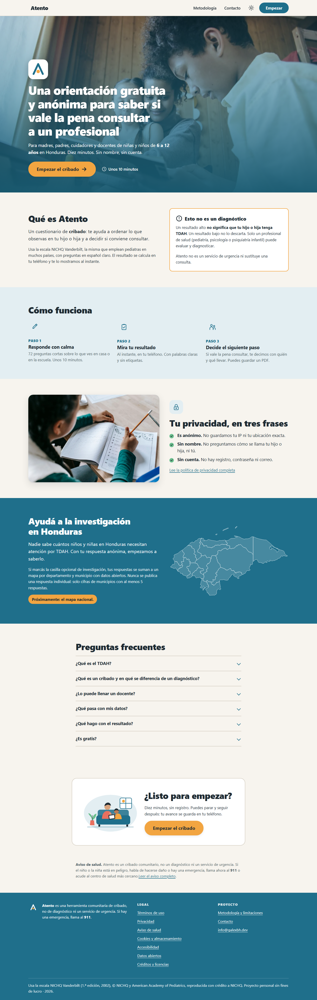
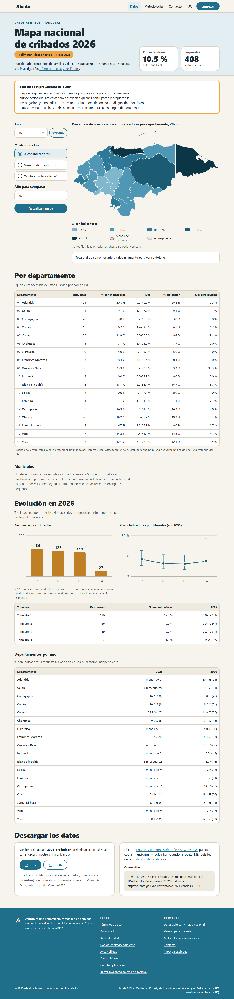

<div align="center">
  
  <h1>Atento</h1>
  <p><strong>Cribado comunitario y gratuito de TDAH infantil para Honduras</strong></p>
  <p>
    <a href="https://atento.galexbh.dev">Sitio</a> ·
    <a href="https://atento.galexbh.dev/metodologia">Metodología</a> ·
    <a href="https://atento.galexbh.dev/datos">Datos abiertos</a> ·
    <a href="./CONTRIBUTING.md">Contribuir</a>
  </p>
  <p>
    <a href="https://github.com/galexbh/atento/actions/workflows/ci.yml"></a>
    <a href="./LICENSE"></a>
    <a href="https://creativecommons.org/licenses/by/4.0/"></a>
    
  </p>
</div>

---

> [!IMPORTANT]
> **Atento es un cribado, no un diagnóstico.** Un resultado con indicadores significa que vale la
> pena consultar con un pediatra, psicólogo o psiquiatra infantil. Solo un profesional de salud
> puede diagnosticar el TDAH.

## Acerca del proyecto

En Honduras hay pocos datos sobre el trastorno por déficit de atención e hiperactividad (TDAH) en
la niñez y muchas familias no saben cuándo conviene pedir una evaluación. Atento ofrece un
cuestionario breve, gratuito y anónimo para madres, padres, cuidadores y docentes de niñas y niños
de 6 a 12 años. Al terminar entrega una orientación clara sobre el siguiente paso.

Con el permiso de cada familia, las respuestas anónimas se suman a un **mapa nacional** que puede
servir a investigadores, escuelas y servicios de salud para dimensionar la necesidad de atención.

<p align="center">
  
  
</p>

## Características

- **Cuestionario para familias** basado en la escala NICHQ Vanderbilt para padres, con progreso
  guardado en el dispositivo y resultado inmediato, incluso sin conexión.
- **Versión para docentes**, porque el TDAH requiere observar señales en casa y en la escuela. La
  familia invita al docente con un código y ninguno puede ver las respuestas del otro.
- **Resultado orientativo** con explicación en lenguaje sencillo, gráfico por área, qué hacer
  ahora y una hoja imprimible para llevar a consulta.
- **Mapa nacional de datos abiertos** por departamento y año, con descarga en CSV y JSON.
- **Privacidad por diseño.** No se piden nombres, correos ni ubicación precisa. Las estadísticas
  públicas ocultan grupos pequeños para impedir que alguien deduzca respuestas individuales.
- **Sin inteligencia artificial en producción.** La puntuación es determinista, reproducible y
  está cubierta por pruebas.
- **Accesible y ligero.** Pensado primero para teléfonos con datos limitados, con modo oscuro,
  navegación por teclado y verificación automática de accesibilidad.

## Principios

| Principio | En la práctica |
| --- | --- |
| Cribar no es diagnosticar | El sitio orienta y refiere; nunca etiqueta a un niño o niña. |
| Mínimos datos | Solo municipio, edad en años, sexo, quién responde y las respuestas. |
| Consentimiento explícito | Compartir datos para investigación es opcional y va en una casilla aparte. |
| Transparencia | La metodología, los puntos de corte y las limitaciones son públicos. |
| Revisión experta | Los textos que leen las familias requieren aprobación clínica antes de publicarse. |

## Empezar

### Requisitos

- Node.js 24 o superior
- [pnpm](https://pnpm.io) 12

### Instalación

```bash
git clone https://github.com/galexbh/atento.git
cd atento
pnpm install
cp .dev.vars.example .dev.vars   # variables locales de desarrollo
pnpm db:migrate:local            # crea la base de datos local
pnpm dev                         # http://localhost:4321
```

Para trabajar con datos de ejemplo:

```bash
pnpm seed -- --n 500
```

### Comandos

| Comando | Descripción |
| --- | --- |
| `pnpm dev` | Servidor de desarrollo |
| `pnpm build` | Compilación de producción |
| `pnpm check` | Verificación de tipos |
| `pnpm lint` | Lint y formato con Biome |
| `pnpm test` | Pruebas unitarias |
| `pnpm test:workers` | Pruebas de la API con base de datos real |
| `pnpm test:e2e` | Pruebas de extremo a extremo y de accesibilidad |

## Tecnología

[Astro](https://astro.build) y TypeScript en modo estricto, validación con
[Zod](https://zod.dev), base de datos SQLite, [Vitest](https://vitest.dev) y
[Playwright](https://playwright.dev) con axe-core para pruebas, y [Biome](https://biomejs.dev)
para lint y formato.

## Estructura

```
├── docs/          Documentación clínica, legal, metodológica y de investigación
├── migrations/    Esquema de la base de datos
├── public/        Recursos estáticos (marca, ilustraciones, mapa)
├── scripts/       Utilidades de desarrollo
├── src/
│   ├── components/   Componentes de interfaz
│   ├── content/      Textos legales, metodología y resultados
│   ├── data/         Instrumentos y catálogo de departamentos y municipios
│   ├── lib/          Puntuación, validación, publicación de datos
│   └── pages/        Rutas del sitio y de la API
└── tests/         Pruebas unitarias, de API y de extremo a extremo
```

## Documentación

| Documento | Contenido |
| --- | --- |
| [Marco clínico](./docs/01-marco-clinico.md) | Qué es el TDAH, cribado frente a diagnóstico e instrumentos revisados |
| [Instrumento](./docs/02-instrumento/) | Ítems, reglas de puntuación, textos de resultado y versión docente |
| [Legal](./docs/03-legal/) | Términos, privacidad, consentimiento y datos abiertos (borradores) |
| [Metodología pública](./docs/06-metodologia-publica.md) | Cómo se construye el mapa y sus limitaciones |
| [Créditos de imágenes](./docs/08-creditos-imagenes.md) | Autoría y licencias de fotografías e ilustraciones |

## Estado del proyecto

Atento está en **versión 0.x**. El sitio funciona, pero estos puntos siguen abiertos:

- [ ] Revisión clínica de los textos, umbrales e ítems propios
- [ ] Revisión legal de las páginas de términos, privacidad y consentimiento
- [ ] Directorio verificado de servicios de salud mental infantil en Honduras
- [ ] Estudio de validación del instrumento con una universidad hondureña

¿Eres profesional de salud, docente o investigador y quieres colaborar? Escribe a
[info@galexbh.dev](mailto:info@galexbh.dev).

## Contribuir

Las contribuciones son bienvenidas. Lee la [guía de contribución](./CONTRIBUTING.md) y el
[código de conducta](./CODE_OF_CONDUCT.md). Cualquier cambio en textos que leen las familias
necesita revisión clínica.

## Seguridad

Si encuentras una vulnerabilidad, **no abras un issue público**. Sigue el proceso de
[SECURITY.md](./SECURITY.md).

## Licencia

| Componente | Licencia |
| --- | --- |
| Código fuente | [MIT](./LICENSE) © 2026 Gabriel Barrientos |
| Datos agregados publicados e ítems propios de Atento | [CC BY 4.0](https://creativecommons.org/licenses/by/4.0/) |
| NICHQ Vanderbilt Assessment Scales | © American Academy of Pediatrics y NICHQ; no cubiertas por las licencias anteriores |
| Nombre y logotipo de Atento | Reservados |

## Agradecimientos

- [NICHQ](https://nichq.org) y la American Academy of Pediatrics por las escalas Vanderbilt.
- [geoBoundaries](https://www.geoboundaries.org) y colaboradores de OpenStreetMap por los límites
  departamentales.
- Fotógrafos de [Pexels](https://www.pexels.com), detallados en los
  [créditos](./docs/08-creditos-imagenes.md).

---

<p align="center">Proyecto comunitario sin fines de lucro · Hecho en Honduras</p>
